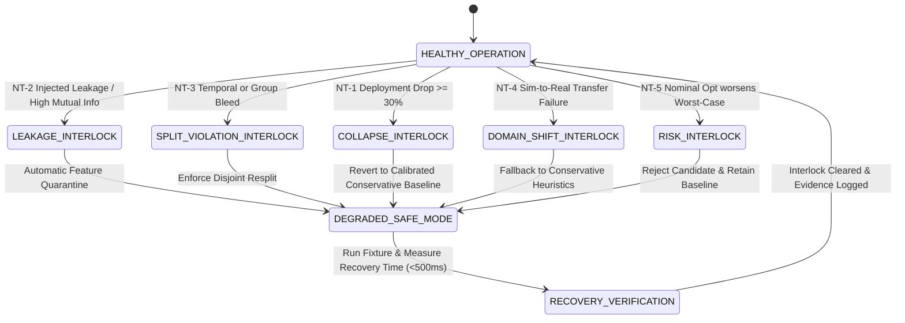

# D1: Engineering Project Charter & System Specification
## Project: Gradient Boosting on Tabular Data With Leakage-Resistant Validation

---

### 1. Executive Summary & Problem Charter
Gradient boosting decision trees (GBDT) are state-of-the-art for tabular prediction. However, tree ensembles excel at exploiting subtle data leakage—specifically features that directly or indirectly encode the target variable, or validation splits that violate temporal ordering and group integrity. In offline validation, leaky models achieve deceptively high scores (e.g., ROC-AUC approaching 1.00), but collapse catastrophically in deployment when operating distributions shift.

The primary beneficiaries of this engineering system are **reliability engineers, system operators, and automated diagnostic controllers**. The engineering mandate is:
> **"Deliver tabular modelling with leakage detected before deployment rather than diagnosed after it."**

---

### 2. System Boundary & Permitted Scope

#### Included in Scope:
1. **O1 Baseline**: Tabular prediction baseline utilizing Gradient Boosted Decision Trees on industrial condition monitoring datasets.
2. **O2 Reference**: Reproducible feature importance analysis comparing at least two reference approaches (Mean Decrease in Impurity vs. Permutation Importance) under a frozen resource envelope.
3. **O3 Contribution**: Subsystem to detect features that indirectly encode the target variable through non-linear mutual information, proxy reconstruction, out-of-fold shift analysis, and shadow feature sensitivity.
4. **O4 Integration**: Operable pipeline enforcing temporal and group separation in validation splits with strict telemetry contracts, safety interlock controllers, degraded modes, and bounded recovery.
5. **O5 Acceptance**: Automated acceptance harness validating AC-1 to AC-4, KPI-1 to KPI-6, and all 5 mandatory negative tests (NT-1 to NT-5).

#### Explicitly Excluded from Scope:
- Unvalidated standalone scripts, isolated Jupyter notebooks, or dashboard-only demonstrations without an end-to-end operable verification harness.
- Production certification for high-consequence unmonitored physical flight/nuclear systems outside the validated operating envelope.
- Ad-hoc feature removal without baseline-vs-candidate comparative evidence and resource profiling.

---

### 3. Plant and Sensor Domain Specifications

| Sensor / Signal | Description | Engineering Units | Nominal Range | Warning Limit | Safety Envelope (Trip) |
| :--- | :--- | :--- | :--- | :--- | :--- |
| **Temperature** | Bearing/casing thermal sensor | °C | 50.0 – 75.0 | > 85.0 | > 110.0 |
| **Pressure** | Hydraulic / line pressure | kPa | 95.0 – 105.0 | > 115.0 | > 130.0 |
| **Vibration** | Tri-axial RMS vibration velocity | mm/s | 0.50 – 2.00 | > 3.50 | > 5.00 |
| **Rotational Speed** | Main shaft tachometer | RPM | 1200 – 1800 | < 1000 or > 2000 | < 800 or > 2200 |
| **Operating Hours** | Monotonic machine operational run-time | Hours | 0 – 10,000 | > 8,000 | > 12,000 |
| **Ambient Temp** | Environmental intake sensor | °C | 15.0 – 35.0 | > 40.0 | > 50.0 |
| **Load Percent** | Mechanical load fraction | % | 40.0 – 80.0 | > 90.0 | > 100.0 |

* **Control / Ingestion Period**: 1 hour discrete sampling window ($\Delta t = 1\text{ h}$).
* **Target Variable**: Binary failure state ($y \in \{0, 1\}$), where $1$ denotes critical functional failure within the forecast horizon.

---

### 4. Safety Interlock Architecture & State Transitions

The system incorporates an explicit closed-loop safety interlock mechanism to prevent compromised models from actuating or generating false operational assurance:

---

### 5. Frozen Resource Envelope (AC-4)

To guarantee scientific rigor and defend claims before the panel, all baseline and candidate evaluations are constrained to the following frozen environment:
- **Language**: Python 3.14+ (pinned virtual environment)
- **Key Dependencies**: `pandas==3.0.5`, `numpy==2.5.2`, `scikit-learn==1.9.0`, `fastapi==0.141.1`, `joblib==1.5.3`
- **Workload**: 5,000 industrial machine condition monitoring records, 7 legitimate sensor features.
- **Seeds & Determinism**: Fixed PRNG seed `random_state=42` across all splits, models, and noise injection fixtures.
